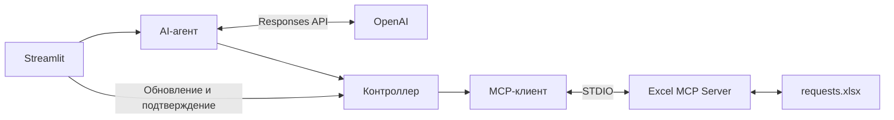

# Архитектура Excel AI Agent

Реализованы STDIO-клиент, инициализация, контроллер, агент OpenAI Responses API, интерфейс Streamlit и журнал MCP. Ниже описана архитектура по [PRD.md](PRD.md).

## Роли компонентов

- **Streamlit** показывает таблицу, чат и журнал. В `st.session_state` хранятся история, текущий фильтр, ожидающее подтверждение и идентификаторы завершённых операций.
- **AI-агент** получает схемы разрешённых инструментов из ответа MCP `list_tools()`, адаптирует их к Responses API и передаёт результаты вызовов модели. Модель выбирает инструмент и аргументы.
- **Контроллер** проверяет список разрешённых инструментов, аргументы, книгу, лист, диапазон и условия записи. Путь и лист берутся из настроек приложения. Контроллер вычисляет или проверяет следующий ID по актуальным данным и проверяет запись повторным чтением.
- **MCP-клиент** запускает существующий сервер дочерним процессом, нормализует его ответы и передаёт фактические события в журнал. Все операции с содержимым книги выполняет Excel MCP Server.
- **Команды инициализации и сброса** используют тот же MCP-клиент. Инициализация создаёт учебную книгу при её отсутствии. Сброс требует явного подтверждения.

## Цикл агента

`run_turn()` открывает MCP-сессию на один запрос. Адаптер использует схемы из `list_tools()` и убирает из них аргументы пути и листа, которые контроллер подставляет из настроек. В OpenAI запросы уходят с `store=False`. Агент связывает каждый результат с его `call_id` и передаёт элементы ответа в следующем запросе. [Документация OpenAI по вызову функций](https://developers.openai.com/api/docs/guides/function-calling)

Режим чтения и подготовки смены статуса доступен без разрешения на добавление. Приложение включает добавление явным параметром `allow_add`. Ответ о записи и предложение подтверждения формируются из результата контроллера. К моменту возврата предложения исходная MCP-сессия закрыта.

## Таблица и фильтр Streamlit

Агент возвращает запрошенный статус в структурированном ответе и передаёт странице проверенные записи текущей MCP-операции. Код приложения вычисляет совпадения и их количество. После добавления контроллер включает в снимок только подтверждённую контрольным чтением запись. Так таблица обновляется без отдельного подключения к MCP. Кнопка «Обновить» открывает новую сессию чтения, а «Показать все» сбрасывает фильтр в `st.session_state`. [Документация OpenAI о структурированных ответах](https://developers.openai.com/api/docs/guides/structured-outputs)

## Смена статуса

1. Контроллер читает заявку через MCP. Интерфейс показывает её ID, описание, текущий и целевой статусы. MCP-сессия закрывается до ожидания ответа.
2. После подтверждения контроллер открывает новую сессию и сверяет заявку с исходными значениями. Если запись изменилась, потребуется новое подтверждение. Отмена завершает операцию без записи.
3. Контроллер записывает статус и перечитывает заявку, чтобы проверить статус и остальные поля. При неизвестном результате он пытается выяснить состояние чтением без автоматического повтора записи.

В `st.session_state` хранится одно ожидающее подтверждение с идентификатором, снимком заявки и ссылкой на исходную операцию журнала. Перед запуском записи приложение помечает идентификатор использованным. Если поля заявки изменились, новый снимок получает новый идентификатор и требует отдельного нажатия. Вызовы подготовки, проверки и записи сохраняются в одной записи журнала.

## Журнал MCP

Запись в `st.session_state` содержит запрос, итог и события в порядке выполнения. Вызовы берутся из MCP-клиента, а отказы — из контроллера. Перед сохранением журнал заменяет настроенный ключ OpenAI и значения полей с учётными данными. Боковая панель отображает события внутри раскрывающегося блока операции.

## Контекст диалога

Для нового запроса агент получает до восьми предыдущих сообщений чата и ID последней заявки, добавление или статус которой были проверены. Детали журнала MCP остаются в сессии Streamlit. Контекст помогает разрешить ссылку «её», а источник актуальных полей перед записью — новая MCP-проверка. Ключ OpenAI используется на стороне приложения и исключается из журнала и интерфейса.

## Инициализация книги

Команда создаёт книгу во временной папке рядом с рабочим файлом. Создание, запись и контрольное чтение выполняются через MCP в одной сессии. После проверки команда создаёт жёсткую ссылку на готовую книгу по рабочему пути и удаляет временную папку. На NTFS эта операция сохраняет уже существующий файл, даже если он появился во время инициализации.

## Сброс учебного листа

После ввода `СБРОС` команда готовит и проверяет временный лист через MCP. Исходный лист получает резервное имя, а временный — рабочее имя. Резервная копия удаляется после проверки рабочего листа. При сбое до контрольного чтения команда сохраняет резервный лист, если он уже создан, и указывает имена временных листов в диагностике. Рабочий агент не получает инструменты управления листами.

## Чтение строк через MCP

`read_range` требует диапазон с начальной и конечной ячейками. Метаданные MCP не содержат номера последней строки. Согласованная область учебной таблицы — `A1:D1001`, включая заголовки и 1000 строк данных. Контроллер читает её целиком, учитывает заявки после пустых строк и отклоняет операции при наличии данных в контрольной строке 1002. Ручные записи ниже контрольной строки находятся вне проверяемой области.

При записи контроллер перечитывает таблицу и заранее проверяет лимит вызовов с учётом контрольного чтения. Добавление использует максимальный ID в учебной области и проверяет, что выбранная строка пуста. Прямой вызов `write_cell` из агента только готовит снимок заявки для подтверждения. В приложении запись и контрольное чтение выполняются последовательно под общей блокировкой записи внутри одного процесса.
